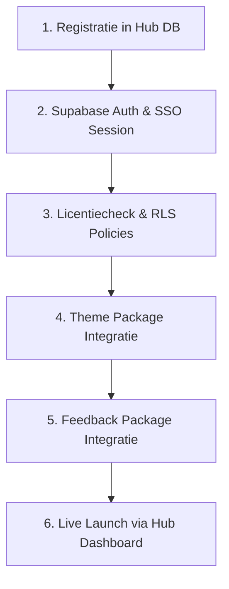

# SchrobbeDock - Spoke App Integratiegids

> **Documenttype**: Technische & Architectonische Ontwikkelingsgids  
> **Doelgroep**: Ontwikkelaars & Antigravity agents die een nieuwe Spoke app ontwerpen of bouwen.  
> **Doel**: Een uniforme blauwdruk bieden om een nieuwe applicatie naadloos in te pluggen in het SchrobbeDock ecosysteem.

---

## 1. De Hub & Spoke Principes voor Spoke Apps

Elke applicatie binnen het ecosysteem is een **Spoke**. Om wildgroei en versnippering te voorkomen, gelden strikte architectuurregels:

1. **Geen eigen authenticatie**: Een Spoke bouwt NOOIT eigen inlog- of registratieschermen. De gebruiker logt in via de centrale Hub.
2. **Licentie-afgedwongen toegang**: Een Spoke app kan uitsluitend worden gebruikt door gebruikers die een actieve licentie hebben in de centrale licentietabel (`public.licenses`).
3. **Data-isolatie First**: Data van een Spoke wordt logisch strikt geïsoleerd van andere apps via een eigen PostgreSQL schema (`app_<slug>`) of via strikte Row Level Security (RLS) policies.
4. **Centrale Ecosystem Packages**: Elke Spoke gebruikt de gedeelde packages voor authenticatie & licenties (`schrobbedock_auth`), styling (`schrobbedock_theme`) en storingsmeldingen (`schrobbedock_feedback`).
5. **Spoke-to-Hub Alert Rule**: Stuit een Spoke op ontbrekende centrale RPC's of tabellen? Meld dit direct proactief via een overdrachtsbericht naar de Hub repo.

---

## 2. Stappenplan: Een Nieuwe Spoke App Opzetten



---

### Stap 1: De App Registreren in de Hub Database

Maak in de SchrobbeDock repository een nieuwe Supabase migratie aan om de app te registreren in `public.apps`:

```sql
-- Voorbeeld: supabase/migrations/20261101000000_register_dock_planner.sql
INSERT INTO public.apps (
    id,
    name,
    slug,
    description,
    launch_url,
    icon_name,
    github_repo_owner,
    github_repo_name,
    is_active
) VALUES (
    gen_random_uuid(),
    'Dock Planner',
    'dock_planner',
    'Planning en tijdlijnbeheer voor scheepsdockingen en onderhoudsbeurten.',
    'https://planner.robbedillen.be',
    'calendar_month',
    'SchrobbeD',
    'dock_planner',
    true
) ON CONFLICT (slug) DO UPDATE SET
    name = EXCLUDED.name,
    description = EXCLUDED.description,
    launch_url = EXCLUDED.launch_url;
```

* **`slug`**: Unieke identifier (kleine letters, underscores). Deze wordt gebruikt in licenties, feedbackmeldingen en RLS policies.
* **`github_repo_owner` & `github_repo_name`**: Zorgt ervoor dat storingsmeldingen vanuit de app automatisch als GitHub Issue in de juiste repository belanden.

---

### Stap 2: Single Sign-On (SSO) & Licentiebewaking (`schrobbedock_auth`)

Gebruik altijd de centrale package `schrobbedock_auth` om inlogstatus, licenties, het inwisselen van invite-codes én toegangsaanvragen automatisch af te handelen:

#### 1. Toevoegen in `pubspec.yaml`:
```yaml
dependencies:
  schrobbedock_auth:
    git:
      url: https://github.com/SchrobbeD/SchrobbeDock.git
      path: packages/schrobbedock_auth
      ref: auth-v1.0.0
```

#### 2. LicenseGate & UserMenu inzetten:
Omwikkel het hoofdscherm van je app met `LicenseGate`. Dit vangt automatisch niet-ingelogde gebruikers (met Hub-redirect), ontbrekende licenties (met code-inwisselveld en "Toegang Aanvragen" knop voor de beheerder) en openstaande aanvragen af:

```dart
// main.dart
MaterialApp(
  home: const LicenseGate(
    appSlug: 'dock_planner',
    appName: 'Dock Planner',
    child: HomeScreen(),
  ),
);

// In de AppBar van HomeScreen:
AppBar(
  title: const Text('Dock Planner'),
  actions: [
    const SchrobbeDockUserMenu(), // Avatar met profiel- en uitlogmenu
  ],
)
```

---

### Stap 3: Licentiecontrole & Data-isolatie (PostgreSQL & RLS)

#### Data Schema Structuur:
Plaats tabellen van de Spoke app bij voorkeur in een eigen PostgreSQL schema, bijvoorbeeld `app_planner`:

```sql
CREATE SCHEMA IF NOT EXISTS app_planner;

CREATE TABLE app_planner.projects (
    id UUID PRIMARY KEY DEFAULT gen_random_uuid(),
    user_id UUID NOT NULL REFERENCES auth.users(id) ON DELETE CASCADE,
    title TEXT NOT NULL,
    status TEXT NOT NULL DEFAULT 'draft',
    created_at TIMESTAMPTZ NOT NULL DEFAULT now()
);

-- RLS Activeren
ALTER TABLE app_planner.projects ENABLE ROW LEVEL SECURITY;
```

#### Strikte Row Level Security (RLS) Policy:
Zorg dat gebruikers enkel rijen kunnen lezen of bewerken als zij over een **actieve licentie** voor deze specifieke app beschikken:

```sql
CREATE POLICY "Gebruikers met licentie hebben toegang tot projecten"
ON app_planner.projects
FOR ALL
TO authenticated
USING (
    EXISTS (
        SELECT 1 FROM public.licenses l
        JOIN public.apps a ON a.id = l.app_id
        WHERE a.slug = 'dock_planner'
          AND l.user_id = auth.uid()
          AND (l.expires_at IS NULL OR l.expires_at > now())
    )
    AND user_id = auth.uid()
);
```

---

### Stap 4: Thematisering & Huisstijl (`schrobbedock_theme`)

Spoke apps importeren de gedeelde themamodule rechtstreeks via Git met een **vaste release tag**:

#### 1. Toevoegen in `pubspec.yaml`:
```yaml
dependencies:
  flutter:
    sdk: flutter
  schrobbedock_theme:
    git:
      url: https://github.com/SchrobbeD/SchrobbeDock.git
      path: packages/schrobbedock_theme
      ref: theme-v1.1.0 # Pin altijd op een stabiele release tag!
```

#### 2. Themacontroller koppelen in Flutter:
De themamodule leest de voorkeuren direct uit `auth.users.raw_user_meta_data.preferences` (via de Supabase JWT). Hierdoor heeft de Spoke app 0 latency en neemt direct de Dark/Light mode en de gekozen accentkleur van de gebruiker over.

```dart
// Framework-agnostisch (ChangeNotifier):
final themeController = SchrobbeDockThemeController(
  initialPreferences: UserThemePreferences.fromMap(
    supabase.auth.currentUser?.userMetadata?['preferences'] as Map<String, dynamic>?,
  ),
);

// In MaterialApp:
MaterialApp(
  theme: SchrobbeDockTheme.buildLightTheme(themeController.preferences),
  darkTheme: SchrobbeDockTheme.buildDarkTheme(themeController.preferences),
  themeMode: themeController.preferences.themeMode,
  ...
);
```

---

### Stap 5: Centraal Probleem- & Feedbackmeldsysteem (`schrobbedock_feedback`)

Elke Spoke app biedt gebruikers een directe manier om fouten of suggesties te melden. Deze worden server-side automatisch gekoppeld aan de GitHub repository van de Spoke app.

#### 1. Toevoegen in `pubspec.yaml`:
```yaml
dependencies:
  schrobbedock_feedback:
    git:
      url: https://github.com/SchrobbeD/SchrobbeDock.git
      path: packages/schrobbedock_feedback
      ref: feedback-v1.2.0 # Pin altijd op een stabiele release tag!
```

#### 2. Eenvoudige Integratie (1 Regel Code):
Plaats een knop in de AppBar of navigatie van je Spoke app:

```dart
IconButton(
  icon: const Icon(Icons.help_outline),
  tooltip: 'Probleem of suggestie melden',
  onPressed: () {
    SchrobbeDockFeedback.show(
      context,
      appSlug: 'dock_planner', // Exact dezelfde slug als geregistreerd in public.apps!
    );
  },
)
```

#### 3. Communicatieportaal & Statuspagina (Optioneel):
Wil je de gebruiker in je Spoke app direct een chat laten voeren over zijn gemelde tickets?
```dart
// Opent het volledige interactieve statusportaal:
SchrobbeDockFeedback.showPortal(context, appSlug: 'dock_planner');
```

---

### Stap 6: CI/CD & Automatische Web Deployment (One.com / SFTP)

Nieuwe Spoke apps die met `scripts/create_spoke.ps1` zijn gegenereerd, bevatten direct een kant-en-klare GitHub Actions workflow (`.github/workflows/deploy_web.yml`) en een Apache rewrite bestand (`web/.htaccess`).

#### 1. Apache SPA Routing (`web/.htaccess`):
Zorgt dat Flutter Web SPA routing (GoRouter) soepel werkt op Apache webservers (zoals One.com) en voorkomt 404-fouten bij direct openen of verversen van URLs:
```apache
<IfModule mod_rewrite.c>
  RewriteEngine On
  RewriteBase /
  RewriteCond %{REQUEST_FILENAME} -f [OR]
  RewriteCond %{REQUEST_FILENAME} -d
  RewriteRule ^ - [L]
  RewriteRule ^ index.html [L]
</IfModule>
```

#### 2. Benodigde GitHub Repository Secrets:
Configureer in GitHub onder **Settings** ➔ **Secrets and variables** ➔ **Actions**:
* `ONE_SFTP_SERVER`: bijv. `ssh.c49x8am1a.service.one`
* `ONE_SFTP_USER`: je SFTP gebruikersnaam / login
* `ONE_SFTP_PASSWORD`: je SFTP wachtwoord
* `ONE_REMOTE_PATH`: de doelmap voor het subdomein (bijv. `/www/dock-planner.robbedillen.be`)
* `PROD_SUPABASE_URL`: `https://supabase.robbedillen.be`
* `PROD_SUPABASE_ANON_KEY`: de openbare Supabase anon key

---

## 3. Checklist voor Release & Go-Live

Controleer voor elke nieuwe Spoke app de volgende punten:

- [ ] Record aangemaakt in `public.apps` met correcte `github_repo_owner` en `github_repo_name`.
- [ ] PostgREST schema permissions geconfigureerd (`GRANT USAGE ON SCHEMA app_<slug> TO authenticated`).
- [ ] Row Level Security (RLS) policies gevalideerd tegen `public.user_licenses`.
- [ ] `packages/schrobbedock_auth` geïmplementeerd (`LicenseGate` + `SchrobbeDockUserMenu`).
- [ ] `packages/schrobbedock_theme` gepind op een stabiele `theme-vX.Y.Z` Git tag (`theme-v1.1.0`).
- [ ] `packages/schrobbedock_feedback` geconfigureerd met de juiste `appSlug`.
- [ ] Ongeautoriseerde bezoeken worden via `LicenseGate` netjes afgehandeld (met `claim_invitation` en `request_app_access`).
- [ ] Apache SPA routing configuratie (`web/.htaccess`) aanwezig.
- [ ] GitHub Actions CI/CD pipeline (`.github/workflows/deploy_web.yml`) geconfigureerd met repository secrets.
